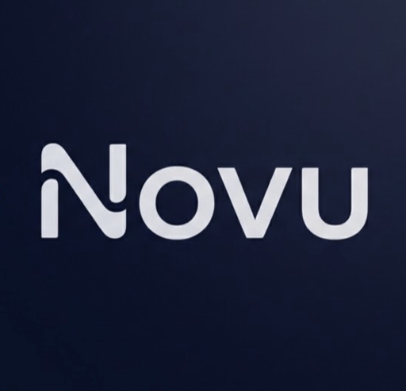
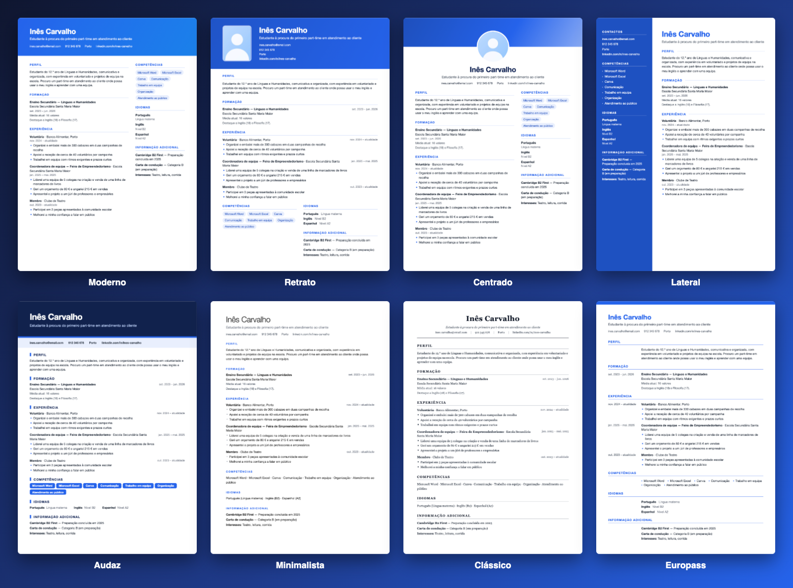
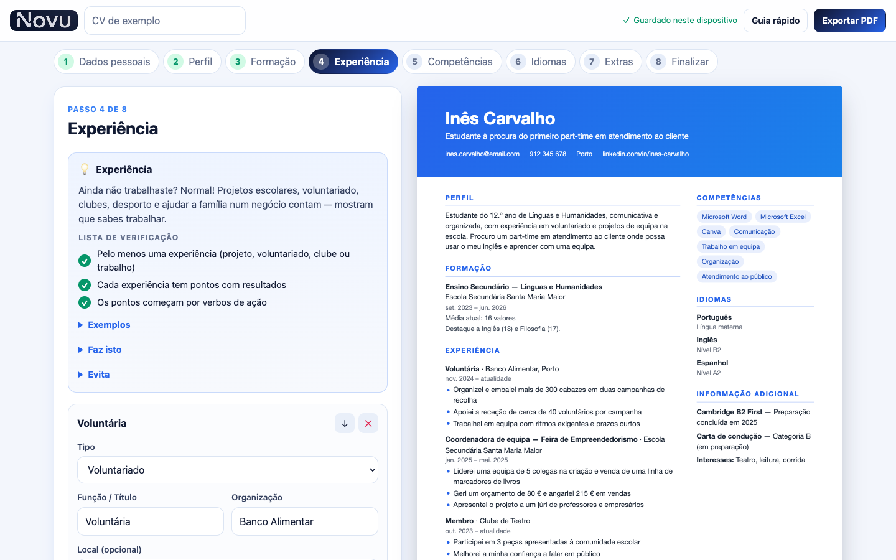
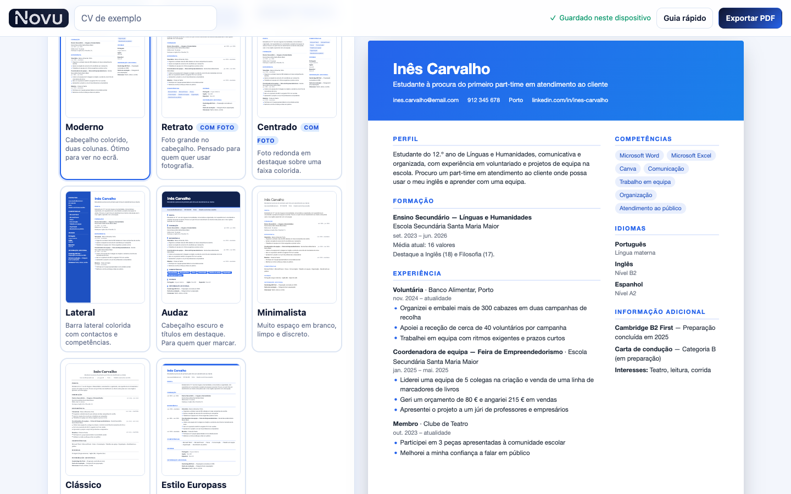

<div align="center">



# Novu

**Build your first CV in minutes, with tips at every step.**
A free, private CV builder for students and first-time job seekers. No accounts, no server, nothing leaves your device.


[Features](#-features) · [Screenshots](#-screenshots) · [Quick start](#-quick-start) · [Deploy](#-deploy) · [How it works](#-how-it-works) · [Roadmap](#-roadmap)

<br />


</div>

<br />

## Why Novu

Your first CV is the hardest one: you have little or no work experience, and most CV tools assume you do. Novu is built for that moment. It walks you through each section, shows you good and bad examples, and helps you turn school projects, volunteering, clubs and languages into a CV that looks professional.

The interface is in **European Portuguese** (informal "tu") and follows Portuguese CV conventions, with the strings structured so other languages are easy to add.

## ✨ Features

|  |  |
|---|---|
| 🧭 **Guided builder** | Eight steps: personal details, profile, education, experience, skills, languages, extras and a final review. |
| 💡 **Tips as you type** | Do and don't lists, weak-vs-better examples, action verbs you can click to insert, and a checklist that ticks itself. |
| 👀 **Live A4 preview** | See the CV take shape while you write, at true A4 proportions. |
| 🎨 **8 templates** | Moderno, Retrato, Centrado, Lateral, Audaz, Minimalista, Clássico and an Europass-style layout. Two are designed around a photo. |
| 🌈 **Your colours** | 12 presets plus a custom colour picker. Headers and accents follow your choice. |
| 📄 **One-click PDF download** | Downloads an A4 PDF straight away, on desktop and phone. It includes a hidden text layer, so it can be searched, selected and read by applicant tracking systems (ATS). A print option gives a fully vector PDF. |
| 📥 **Import an existing CV** | Upload a PDF, Word (.docx) or text file, review what was found, pick a new template and edit. |
| 📸 **Optional photo** | Cropped and resized in the browser. Placeholders show only on screen, never in the PDF. |
| 💾 **Drafts that stay yours** | Several drafts, autosaved in your browser. Back up or move them with a `.json` file. |
| 📱 **Works on your phone** | Responsive layout with an Edit / Preview switch. |

## 📸 Screenshots

<div align="center">

**Eight templates**



<br /><br />

**Guided steps with live preview and tips**



<br /><br />

**Pick a template, colour and photo**



</div>

## 🚀 Quick start

Requires Node 18 or newer.

```bash
git clone https://github.com/danuherwill-dot/Novu-CV-Builder.git
cd Novu-CV-Builder
npm install
npm run dev        # http://localhost:5173
```

```bash
npm run build      # type-check and build to dist/
npm run preview    # serve the production build locally
```

## 🌍 Deploy

The build is plain static files (`dist/`) with relative paths, so it runs on any static host.

<details>
<summary><b>Netlify</b></summary>

Import the repository, then set **Build command** to `npm run build` and **Publish directory** to `dist`. Or drag the `dist/` folder onto app.netlify.com.

</details>

<details>
<summary><b>Vercel</b></summary>

Import the repository. Vercel detects Vite automatically (`npm run build`, output `dist`).

</details>

<details>
<summary><b>GitHub Pages</b></summary>

In **Settings → Pages**, choose **GitHub Actions** and add `.github/workflows/pages.yml`:

```yaml
name: Deploy
on: { push: { branches: [main] } }
permissions: { contents: read, pages: write, id-token: write }
jobs:
  build:
    runs-on: ubuntu-latest
    steps:
      - uses: actions/checkout@v4
      - uses: actions/setup-node@v4
        with: { node-version: 20 }
      - run: npm ci && npm run build
      - uses: actions/upload-pages-artifact@v3
        with: { path: dist }
  deploy:
    needs: build
    runs-on: ubuntu-latest
    environment: { name: github-pages }
    steps:
      - uses: actions/deploy-pages@v4
```

</details>

## 🔒 Privacy

Novu has no backend and no analytics. Everything happens in your browser:

- Drafts are stored in `localStorage` on your device.
- Imported files are read locally (`pdf.js` for PDFs, `mammoth` for Word) and never uploaded.
- Photos are cropped and compressed locally.
- Clearing your browser data deletes your drafts, so use **Download backup (.json)** to keep a copy.

## 🛠 How it works

```
src/
├─ i18n/pt.ts            all UI text, tips and CV labels (European Portuguese)
├─ components/
│  ├─ Steps.tsx          the form for each step
│  ├─ CVDocument.tsx     the 8 templates (one component, one layout per template)
│  ├─ Preview.tsx        scaled live preview + the unscaled copy used for PDF
│  ├─ TipsCard.tsx       tips, examples and checklist
│  ├─ ImportModal.tsx    drag-and-drop CV import
│  └─ Home.tsx           landing screen and draft list
├─ cv.css                template styles, sized in mm/pt so screen and PDF match
├─ exportPdf.ts          direct PDF download (render + invisible text layer)
├─ importCV.ts           file reading and CV parsing (headings, dates, entries)
├─ checks.ts             the "CV health" checks
└─ store.ts              multi-draft storage with autosave
```

A few design decisions worth knowing:

- **PDF download is generated in the browser** (`html2canvas` + `jsPDF`, loaded on demand): the page is rendered at about 300 dpi and an invisible text layer is added on top for search and ATS. A second option uses the browser's print engine with an A4 `@page` for a fully vector PDF.
- **The preview and the PDF come from the same component.** The preview is scaled with a transform and a second, unscaled copy is used for the PDF. Accent tints are pre-computed (`accentVars.ts`) instead of using CSS `color-mix()`, which `html2canvas` cannot parse.
- **CV import is rule-based, not AI.** It detects Portuguese and English section headings (including letter-spaced ones like "P E R F I L"), splits two-column layouts, parses dates and groups entries. It was tested by round-tripping PDFs exported from the templates, but real-world CVs vary, so users are asked to review each step.
- **Adding a language** means copying `src/i18n/pt.ts` to `en.ts`, translating the values and registering it in `src/i18n/index.ts`.

## 🗺 Roadmap

- [ ] English interface
- [ ] Photo import from uploaded CVs
- [ ] Installable offline app (PWA)
- [ ] Cover letter builder
- [ ] More templates and font choices

## Contact

Questions or ideas? Open an [issue](https://github.com/danuherwill-dot/Novu-CV-Builder/issues).
